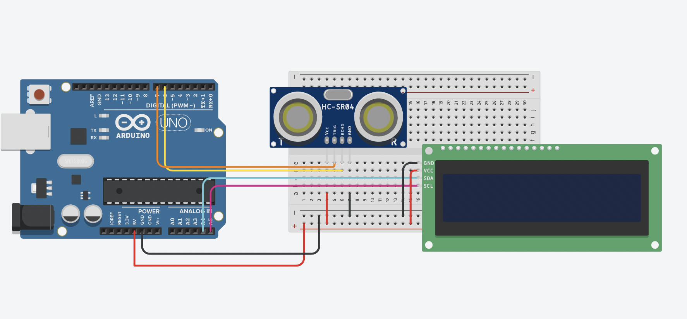

# Brainy Scale — ultrasonic distance meter

Measures distance with an HC-SR04 ultrasonic sensor and shows it live on a 16×2 I2C LCD, refreshed twice a second.

## Hardware

| Part | Connection |
|---|---|
| Arduino Uno | — |
| HC-SR04 trig / echo | pins 7 / 6 |
| 16×2 LCD with I2C backpack | SDA / SCL, address `0x27` |

## How it works

1. Send a 10 µs pulse on `trig`, time the echo with `pulseIn`.
2. Distance (cm) = (duration / 2) / 29.1 — sound takes ≈ 29.1 µs per cm, halved for the round trip.
3. Print it to the LCD with one decimal place, and to the Serial Monitor.

## Run it

1. Install the **LiquidCrystal I2C** library (Arduino IDE → Library Manager).
2. Open `ultrasonic_i2c.ino`, upload to the Uno.
3. The LCD shows "Distance Meter", then live readings. If the screen stays blank, your LCD may use address `0x3F` instead of `0x27`.
